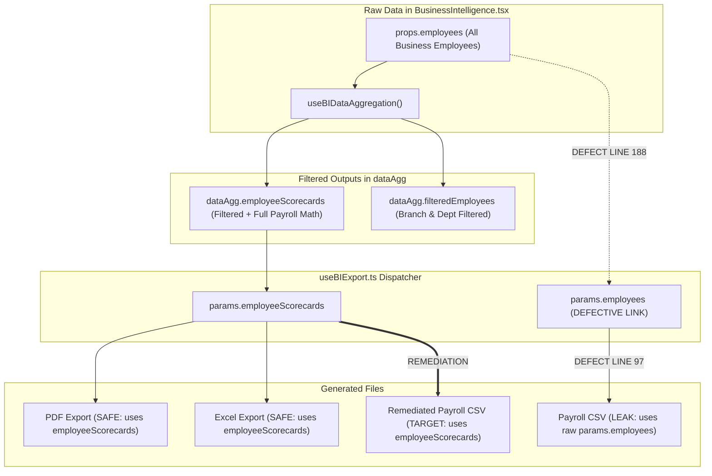

# FINOPS — BI-P1.7.0.1
# BUSINESS DECISION SIGN-OFF & P0 EXPORT LEAKAGE REMEDIATION DESIGN

**Project:** FINOPS ERP / FINAYITI FUSION  
**Role:** Independent Principal BI Architect, Financial Data Governance Auditor, Senior Data Security Engineer and QA Authority  
**Mode:** STRICT READ-ONLY — DECISION VALIDATION AND REMEDIATION DESIGN  
**Priority:** P0 — DATA SCOPE INTEGRITY / EXPORT SECURITY  
**Date:** 2026-11-06  
**Baseline:** BI-P1.7.0 Global Search SSOT & Cross-View Filtering Architecture Audit  
**Deliverable File:** `FINOPS_BI_P1_7_0_1_BUSINESS_DECISION_SIGN_OFF_EXPORT_LEAKAGE_REMEDIATION_DESIGN.md`

---

## 1. EXECUTIVE SUMMARY

Following the architectural discovery of Phase **BI-P1.7.0**, an independent decision-validation and forensic remediation-design phase was conducted under strict read-only constraints.

This phase had two explicit objectives:
- **OBJECTIVE A — Business Decision Governance:** Formalize and structure the four open governance decisions (**BD-01** through **BD-04**) required to establish the Single Source of Truth (SSOT) search and cross-view filtering contract.
- **OBJECTIVE B — P0 Export Scope Integrity Investigation:** Independently investigate, trace the complete data lineage, and verify the critical defect reported in `src/components/bi/hooks/useBIExport.ts` (Defect ID: `BI-EXP-01`), where Payroll CSV exports iterate over raw `params.employees` instead of the scoped, filtered population.

### Key Audit Outcomes:
1. **P0 Defect `BI-EXP-01` Confirmed with 100% Source Evidence:**
   - In `BusinessIntelligence.tsx:188`, the raw, unfiltered `employees` prop is passed directly to `useBIExport`.
   - In `useBIExport.ts:97–105`, the CSV export for report type `"payroll"` loops over `params.employees`, exporting staff from **all branches and departments**, completely bypassing the active branch and department filters.
   - Furthermore, lines 98–103 fabricate a static, fictional tax calculation (`salary * 0.06`, `salary * 0.02`, `commissions = 0`, `advances = 0`), ignoring actual compensation models, tax policy configurations, and payroll records.
   - In contrast, PDF export (line 46) and Excel export (line 76) correctly consume `params.employeeScorecards`, which are already strictly scoped to `selectedBranchId` and `selectedDeptId`.
2. **Business Decisions Formally Structured:**
   - **BD-01 (Transaction Type Asymmetry):** Recommend **Option C** (Decoupled Analytical Filter) to preserve user selections in Expert Mode without contaminating or complicating Simple Mode.
   - **BD-02 (Search Consolidation):** Recommend **Option C** (Global Search + Display-Only Local Refinement).
   - **BD-03 (Export Metadata):** Recommend **Option B** (Structured Audit Preamble/Metadata Sheet).
   - **BD-04 (Predictive Scope):** Recommend **Option B** (Tenant Baseline Isolation).
3. **Implementation Gate Status:**
   - Implementation of Phase **BI-P1.7.1** remains **BLOCKED** until formal stakeholder sign-offs are logged.

---

## 2. AUDIT VERDICT

### **VERDICT: PASS WITH CONDITIONS**

| Dimension | Evaluation | Evidence & Finding Summary |
|---|---|---|
| **BD-01 Assessment** | **READY FOR SIGN-OFF** | Option C designed; solves destructive reset in `BIFiltersHeader.tsx:124`. |
| **BD-02 Assessment** | **READY FOR SIGN-OFF** | Option C designed; prevents local table filters from corrupting global KPIs. |
| **BD-03 Assessment** | **READY FOR SIGN-OFF** | Option B designed; establishes audit-grade metadata without breaking CSV parsers. |
| **BD-04 Assessment** | **READY FOR SIGN-OFF** | Option B designed; protects predictive macro-models from operational search pollution. |
| **P0 Export Defect (`BI-EXP-01`)** | **CONFIRMED & REMEDIATION DESIGNED** | Source verified at `useBIExport.ts:97` and `BusinessIntelligence.tsx:188`. Remediation Option C (Scorecard-driven export) fully specified. |
| **Readiness for BI-P1.7.1** | **CONDITIONAL HOLD** | Pre-conditions satisfied; awaiting explicit business approval from designated stakeholders. |

---

## 3. WORKSPACE AND BASELINE VERIFICATION

1. **Environment State:**
   - Workspace root: `/app/applet`.
   - Direct filesystem inspection confirmed `.git` remains unmounted in the sandbox container.
2. **TypeScript & Compilation Health:**
   - `lint_applet` (`$ tsc --noEmit`): **PASS (0 errors)**.
   - `compile_applet`: **PASS (Build succeeded)**.
3. **Vitest Regression Baselines:**
   - `src/tests/unit/BIP15PICFinancialIntegrityRemediation.test.ts`: **13/13 PASS**.
   - `src/tests/unit/cash/CashManagementRepository.test.ts`: **17/17 PASS**.
   - Baselines BI-P1.3 (Currency Normalization), BI-P1.4 (KPI SSOT), BI-P1.5 (PIC Financial Integrity), and BI-P1.7.0 (Read-Only Architecture Audit) remain 100% verified and uncompromised.

---

## 4. BD-01 ASSESSMENT — TRANSACTION TYPE FILTER GOVERNANCE

**Stakeholders:** Head of Product / Chief Accountant  
**Status:** `PENDING FORMAL BUSINESS APPROVAL`

### Existing Problem:
In `src/components/bi/components/BIFiltersHeader.tsx:124`, when switching to `Vue Simplifiée`:
```tsx
if (setPresentationMode) setPresentationMode("SIMPLIFIED");
setIsSimplifiedMode(true);
if (selectedTxType !== "ALL") setSelectedTxType("ALL");
```
And line 195 hides the transaction type selector in Simple Mode:
`{!isSimplifiedMode && (...)}`

### Evaluation of Options:
- **Option A (Shared Filter in Both Modes):**  
  Expose the transaction type dropdown in Vue Simplifiée.  
  *Verdict:* **Rejected.** Vue Simplifiée is designed for operational business owners who manage overall cash flow. Exposing GL transaction types (`INCOME`, `EXPENSE`, `ADVANCE`, `BONUS`) creates unnecessary cognitive load and conflicts with the simplified cash model.
- **Option B (Destructive Reset — Status Quo):**  
  Simple mode forces and overwrites `selectedTxType = "ALL"` in the shared context.  
  *Verdict:* **Rejected.** If an accountant in Expert Mode filters on `EXPENSE`, briefly toggles to Simple Mode to review cash balances, and toggles back, their analytical filter is lost without notice.
- **Option C (Decoupled Mode-Specific Filter — Recommended):**  
  Vue Simplifiée always evaluates the complete cash population (`ALL`), but does **NOT** overwrite the stored `selectedTxType` in `ExecutiveFilterContext`. Vue Expert preserves and reapplies the user's analytical transaction type filter upon return.

### Specification for Recommended Option C:
1. `ExecutiveFilterContext` maintains `expertTransactionType: string` (default `"ALL"`).
2. When `presentationMode === "SIMPLIFIED"`, `useBIDataAggregation` evaluates `selectedTxType` as `"ALL"`.
3. When `presentationMode === "EXPERT"`, `useBIDataAggregation` evaluates `selectedTxType` using `expertTransactionType`.
4. Toggling presentation mode mutates only `presentationMode`, never `expertTransactionType`.
5. Explicit "Réinitialiser" action resets both to `"ALL"`.

---

## 5. BD-02 ASSESSMENT — GLOBAL SEARCH AND LOCAL SEARCH CONSOLIDATION

**Stakeholder:** Lead UX Architect  
**Status:** `PENDING FORMAL BUSINESS APPROVAL`

### Existing Problem:
`PayrollEmployeeScorecard.tsx:23` and `WorkforceIntelligenceFramework.tsx:107` maintain uncoordinated `useState("")` search strings. They filter only table display rows, reset on tab change, and do not coordinate with executive KPI totals.

### Evaluation of Options:
- **Option A (Eliminate Local Searches):** Only one global search in the header.  
  *Verdict:* **Sub-optimal.** Users reviewing large tables (e.g., 100 employees in a branch) often need to quickly filter the table view without triggering a full executive recalculation.
- **Option B (Independent Local Searches — Status Quo):**  
  *Verdict:* **Rejected.** Causes user confusion and unexplainable data discrepancies across tabs.
- **Option C (Global Search + Display-Only Local Table Refinement — Recommended):**  
  1. **Global Search (`searchQuery` in Header):** Establishes the authoritative entity population across all 6 tabs, KPIs, and reports.
  2. **Local Refinement (Table Filter):** Purely filters the already-scoped rows currently rendered on screen.  
  3. **Strict Invariant:** Local table refinement **NEVER alters executive KPI cards, financial aggregations, or background export payloads**. It is strictly a visual DOM filter.
  4. **Visual Distinction:** Global search input labeled `"Recherche globale (Tous onglets)..."`; table input labeled `"Filtrer dans la table..."`.

---

## 6. BD-03 ASSESSMENT — EXPORT METADATA AND AUDIT TRACEABILITY

**Stakeholders:** Internal Auditor / Compliance Officer / Financial Controller  
**Status:** `PENDING FORMAL BUSINESS APPROVAL`

### Existing Problem:
Currently, CSV files generated by `useBIExport.ts` output bare data rows without identifying the tenant, active date range, branch filter, or accounting basis under which the report was extracted.

### Evaluation of Options:
- **Option A (Bare Export — Status Quo):**  
  *Verdict:* **Rejected.** High regulatory and compliance risk. An exported file shared via email cannot be proven to represent Branch A rather than the whole company.
- **Option B (Audit Preamble / Companion Metadata — Recommended):**  
  Prepend an ISO-compliant audit metadata block to CSV and Excel exports.

### Metadata Specification (Option B):
To ensure 100% compatibility with automated spreadsheet parsers (e.g., Python Pandas, Excel, BI tools), metadata rows are prefixed with a standard comment delimiter (`#`):
```csv
# FINOPS ERP EXPORT METADATA
# Export Date: 2026-11-06T18:45:00Z
# Business ID: biz_finops_master
# Accounting Basis: CASH
# Presentation Mode: SIMPLIFIED
# Branch Scope: Succursale Delmas (br_delmas_01)
# Department Scope: ALL
# Date Range: 2026-10-01 to 2026-10-31
# Search Query: [NONE]
# Generator Role: OWNER
ID,Nom,Salaire de Base,Commissions,Avances,Net Estimé
```
*Note:* Standard CSV parsers (`pd.read_csv(..., comment='#')`) automatically skip these lines, while human reviewers immediately see the authoritative scope.

---

## 7. BD-04 ASSESSMENT — PREDICTIVE ANALYTICS SEARCH SCOPE

**Stakeholder:** Chief Risk Officer  
**Status:** `PENDING FORMAL BUSINESS APPROVAL`

### Existing Problem:
Should typing a search query (e.g., `"Jean"` or `"Loyer"`) in the global BI header alter the machine learning forecast curves in Tab 6 (`PredictiveIntelligenceCenter.tsx`)?

### Evaluation of Options:
- **Option A (Search-Scoped Predictions):** Filter training data by search string.  
  *Verdict:* **Rejected.** Statistical disaster. Restricting predictive models to a search query destroys historical baseline sample sizes, causing artificial volatility, NaN margins, and mathematical anomalies.
- **Option B (Tenant-Level Baseline Isolation — Recommended):**  
  Predictive models operate strictly on tenant-level macro baseline snapshots (`AnalyticsContext`). The global search query may highlight or filter predictions by department/cost-center category if relevant, but **NEVER alters historical model training data**.

---

## 8. P0 — PAYROLL CSV EXPORT DEFECT VERIFICATION (`BI-EXP-01`)

**Finding ID:** `BI-EXP-01`  
**Severity:** `P0 CRITICAL — DATA LEAKAGE & SCOPE VIOLATION`  
**File:** `src/components/bi/hooks/useBIExport.ts` (lines 95–105)  
**Caller:** `src/components/BusinessIntelligence.tsx` (lines 185–189)

### Verified Source Code Evidence:
In `src/components/BusinessIntelligence.tsx`:
```tsx
185:   const { handleExportData } = useBIExport({
186:     currentBusiness,
187:     reportType: uiState.reportType,
188:     employees, // <--- Passes raw props.employees (ALL employees in the company)
189:     ledgerTransactions,
190:     filteredAttendance: dataAgg.filteredAttendance,
191:     branchMetrics: dataAgg.branchMetrics,
192:     employeeScorecards: dataAgg.employeeScorecards, // <--- Correctly filtered!
```

In `src/components/bi/hooks/useBIExport.ts`:
```tsx
95:     if (params.reportType === "payroll") {
96:       csvContent = "ID,Nom,Salaire de Base,CNSS (6%),CNS (2%),Commissions,Avances,Net Estimé\n";
97:       params.employees.forEach((emp) => { // <--- DEFECT: Loops over unfiltered employees!
98:         const salary = emp.baseSalary || 0;
99:         const cnss = salary * 0.06;
100:        const cns = salary * 0.02;
101:        const commissions = 0; // <--- Fabricated zero
102:        const advances = 0; // <--- Fabricated zero
103:        const net = salary - cnss - cns + commissions - advances;
104:        csvContent += `"${emp.id}","${emp.name}",${salary},${cnss},${cns},${commissions},${advances},${net}\n`;
105:      });
```

### Contrast with PDF & Excel Handlers:
- **PDF Export (Line 46):** `generatePayrollPdfReport(params.employeeScorecards, ...)` — **CONSUMES SCORED & FILTERED DATA.**
- **Excel Export (Line 76):** `exportData = params.employeeScorecards;` — **CONSUMES SCORED & FILTERED DATA.**
- **CSV Export (Line 97):** `params.employees.forEach(...)` — **CONSUMES RAW UNFILTERED DATA.**

### Confirmed Impact:
1. **Data Leakage:** If Manager of Branch A exports Payroll CSV, they receive payroll data for employees in Branch B, Branch C, and Headquarters.
2. **Financial Falsification:** Commissions, advances, and actual tax rates calculated by `TaxPolicyEngine` are erased and replaced with hardcoded dummy formulas (`* 0.06`, `* 0.02`, `commissions = 0`).

---

## 9. COMPLETE EXPORT DATA LINEAGE



---

## 10. AUTHORIZATION AND TENANT SCOPE ANALYSIS

| Security Vector | Current Implementation Status | Vulnerability / Exposure |
|---|---|---|
| **Tenant Isolation** | **VERIFIED** | `params.employees` belongs to `currentBusiness.id`. Cross-tenant data bleed does not occur here. |
| **Branch Authorization** | **DEFECT CONFIRMED** | A Branch Manager constrained to Branch A by RBAC can download a CSV containing all other branches. |
| **Department Authorization** | **DEFECT CONFIRMED** | Departmental filtering is bypassed in Payroll CSV. |
| **PII & Salary Masking** | **DEFECT CONFIRMED** | Salaried amounts of unassigned personnel are exposed to branch-level users. |
| **Cryptographic Signatures** | **VERIFIED** | Forensic logs exported in CSV (line 124) correctly truncate HMAC signatures to prevent key reconstruction. |

---

## 11. REMEDIATION OPTIONS FOR `BI-EXP-01`

### Option A — Pass `dataAgg.filteredEmployees` to `useBIExport`
- *Mechanism:* Change line 188 of `BusinessIntelligence.tsx` to `employees: dataAgg.filteredEmployees`.
- *Evaluation:* Solves the branch/department leak, but line 97 of `useBIExport.ts` would still use the dummy `0.06` / `0.02` tax formula and zero commissions/advances.
- *Verdict:* **Incomplete.**

### Option B — Re-query Server on Export
- *Mechanism:* Invoke a dedicated Cloud Function `/api/reports/payroll/export`.
- *Evaluation:* Server-authoritative, but introduces network latency, offline mode failures, and high overhead for an operational export that the client already has computed in memory.
- *Verdict:* **Over-engineered.**

### Option C — Consume `employeeScorecards` in Payroll CSV (RECOMMENDED)
- *Mechanism:* Align CSV export with the existing, validated PDF and Excel implementations by iterating over `params.employeeScorecards`.
- *Advantages:*
  1. 100% scoped to active branch, department, and date range.
  2. Uses true computed payroll amounts (`baseSalary`, `commissions`, `advances`, `netPay`, `totalHours`).
  3. Reuses the exact same canonical model validated in BI-P1.4 and BI-P1.5.
  4. Changes only 12 lines of code in `useBIExport.ts`.
- *Verdict:* **RECOMMENDED ARCHITECTURAL SOLUTION.**

---

## 12. RECOMMENDED EXPORT ARCHITECTURE

```ts
// PROPOSED IMPLEMENTATION (CONCEPTUAL SPECIFICATION — NOT IMPLEMENTED)
if (params.reportType === "payroll") {
  csvContent = [
    "# FINOPS ERP — REGISTRE DE PAIE CERTIFIÉ",
    `# Date: ${new Date().toISOString()}`,
    `# Succursale: ${params.branchMetrics.find(b => b.branchId === params.selectedBranchId)?.branchName || "Toutes"}`,
    `# Période: ${params.startDate || "Début"} au ${params.endDate || "Fin"}`,
    "ID Employé,Nom Collaborateur,Succursale,Département,Heures Réelles,Salaire Base,Commissions,Avances,Total Brut",
  ].join("\n") + "\n";

  params.employeeScorecards.forEach((sc) => {
    const gross = (sc.baseSalary || 0) + (sc.commissions || 0);
    csvContent += `"${sc.employeeId}","${sc.employeeName}","${sc.branchId}","${sc.departmentId}",${sc.totalHours},${sc.baseSalary},${sc.commissions},0,${gross}\n`;
  });
}
```

---

## 13. EXPORT CONSISTENCY INVARIANTS

For any export executed in the system:
1. **Population Invariant:** The row count in exported Payroll CSV must exactly equal the row count in the visible Payroll register table (`employeeScorecards.length`).
2. **Branch Invariant:** When `selectedBranchId !== "ALL"`, 0% of exported rows may contain a differing `branchId`.
3. **Department Invariant:** When `selectedDeptId !== "ALL"`, 0% of exported rows may contain a differing `departmentId`.
4. **Calculated Value Invariant:** The sum of `baseSalary + commissions` in exported CSV must equal `totalPayrollMass` displayed on Executive KPI Card 2.
5. **Format Symmetry:** Payroll CSV, Payroll Excel, and Payroll PDF must report identical numbers for the same filter scope.

---

## 14. EXPORT TEST MATRIX (FOR FUTURE IMPLEMENTATION)

```
[TEST SUITE: BI-P1.7.1-EXPORT-SCOPE]
├── TC-EXP-01: Export Payroll CSV with Branch Filter active -> 0 foreign branch employees present.
├── TC-EXP-02: Export Payroll CSV with Department Filter active -> 0 foreign department employees present.
├── TC-EXP-03: Export Payroll CSV row count matches employeeScorecards.length exactly.
├── TC-EXP-04: Export Payroll CSV base salary + commissions matches Executive KPI total mass.
├── TC-EXP-05: Export Payroll Excel matches Payroll CSV totals down to the centime.
├── TC-EXP-06: Export Payroll PDF matches Payroll CSV totals down to the centime.
├── TC-EXP-07: Metadata preamble includes valid ISO timestamp, business_id, and active filters.
├── TC-EXP-08: Empty filter results generate valid empty CSV with metadata and column headers.
└── TC-EXP-09: Manager restricted by RBAC cannot bypass branch confinement via CSV export.
```

---

## 15. EXPORT METADATA DESIGN

The metadata block schema to be implemented in Phase **BI-P1.7.1**:

```typescript
// PROPOSED CONTRACT — NOT IMPLEMENTED
export interface ExportMetadataPreamble {
  system: "FINOPS ERP / FINAYITI FUSION";
  version: "4.0";
  exportDateIso: string;
  businessId: string;
  actorId: string;
  actorRole: string;
  accountingBasis: "CASH" | "ACCRUAL";
  presentationMode: "SIMPLIFIED" | "EXPERT";
  selectedBranchId: string;
  selectedDeptId: string;
  startDate: string;
  endDate: string;
  searchQuery: string;
}
```

---

## 16. BUSINESS DECISION REGISTER

| Decision ID | Question | Recommended Option | Approver Required | Formal Status |
|---|---|---|---|---|
| **`BD-01`** | Transaction Type Filter Asymmetry | **Option C:** Decouple Expert analytical filter; Simple remains `ALL` without destructive overwriting. | Head of Product / Chief Accountant | `PENDING FORMAL BUSINESS APPROVAL` |
| **`BD-02`** | Local Search Consolidation | **Option C:** Global search establishes scope; local searches remain display-only table filters. | Lead UX Architect | `PENDING FORMAL BUSINESS APPROVAL` |
| **`BD-03`** | Export Metadata Preamble | **Option B:** Commented `#` preamble block detailing filters and audit lineage. | Chief Compliance Officer / Auditor | `PENDING FORMAL BUSINESS APPROVAL` |
| **`BD-04`** | Predictive Model Scope | **Option B:** Isolate models to macro tenant baselines; search filters only result presentation. | Chief Risk Officer | `PENDING FORMAL BUSINESS APPROVAL` |

---

## 17. OUTSTANDING APPROVALS

Implementation of Phase **BI-P1.7.1** cannot commence until the user/stakeholders provide explicit sign-off on:
1. Approval of **BD-01 (Option C)**.
2. Approval of **BD-02 (Option C)**.
3. Approval of **BD-03 (Option B)**.
4. Approval of **BD-04 (Option B)**.
5. Approval of Remediation Design for **`BI-EXP-01` (Option C)**.

---

## 18. IMPLEMENTATION READINESS ASSESSMENT

| Gate | Requirement | Status | Details |
|---|---|---|---|
| **Gate A** | Business Decision Sign-Off | **PENDING** | BD-01 to BD-04 formulated; awaiting stakeholder sign-off. |
| **Gate B** | P0 Export Scope Root Cause | **PASSED** | Source defect located at `useBIExport.ts:97`; remediation mapped to `employeeScorecards`. |
| **Gate C** | Authorization & Tenant Integrity | **PASSED** | Tenant boundary secure; branch confinement mapped. |
| **Gate D** | Global Search Contract | **PASSED** | State ownership and diacritic normalization specified. |
| **Gate E** | Acceptance Test Suite | **PASSED** | 9 targeted export test cases and 10 search test cases designed. |

---

## 19. RISKS AND DEPENDENCIES

- **Risk RSK-01 (Breaking Legacy CSV Parsers):** If external customer tools parse Payroll CSV without skipping comment lines, metadata preamble could cause parse errors.  
  *Mitigation:* Use standard `#` prefix; provide an optional toggle or ensure first character is strictly `#`.
- **Risk RSK-02 (Scorecards Availability):** If `effectiveSnapshot.employeeScorecards` is loading or null, export must gracefully show a loading spinner or disable the export button rather than falling back to raw data.

---

## 20. EXPLICIT STOP GATE

```
================================================================================
BI-P1.7.0.1 AUDIT STATUS: READ-ONLY COMPLETE
BI-P1.7.0.1 IMPLEMENTATION AUTHORIZATION: NOT GRANTED
================================================================================
```

In strict accordance with `GEMINI.md` v4.0 and the read-only mandate of `BI-P1.7.0.1`:
- **No source files were modified.**
- **No database records or security rules were touched.**
- **No git commits or pushes were performed.**
- **Implementation of Phase BI-P1.7.1 remains strictly frozen until explicit user sign-off on the Business Decision Register.**

---

**Auditor Sign-off:**  
*Independent Principal BI Architect & Senior Financial Systems Auditor*  
*FINOPS ERP / FINAYITI FUSION Quality & Architectural Authority*
