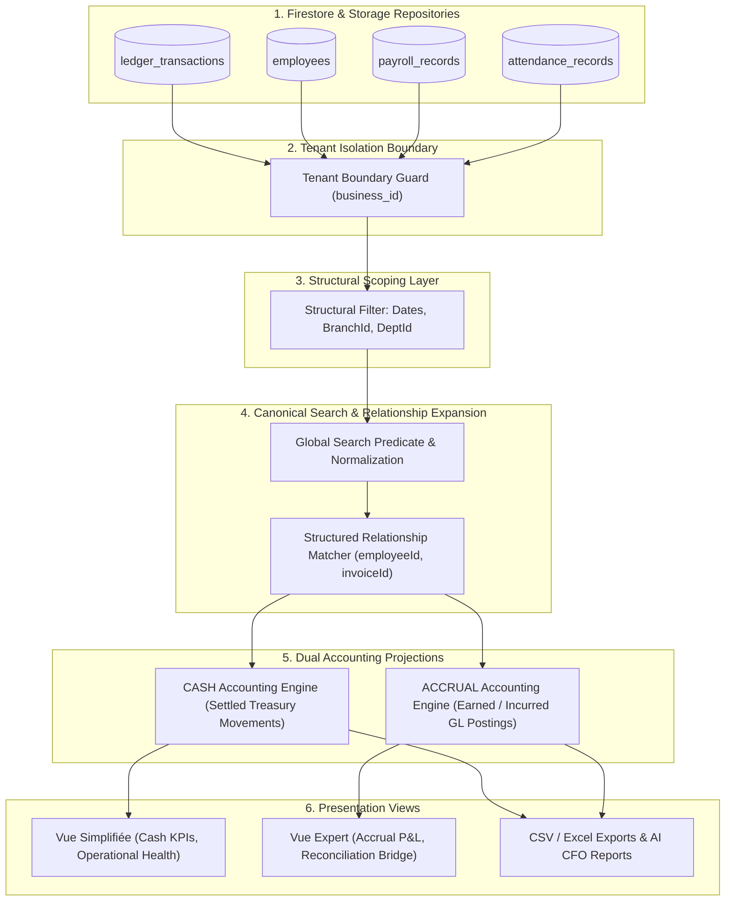
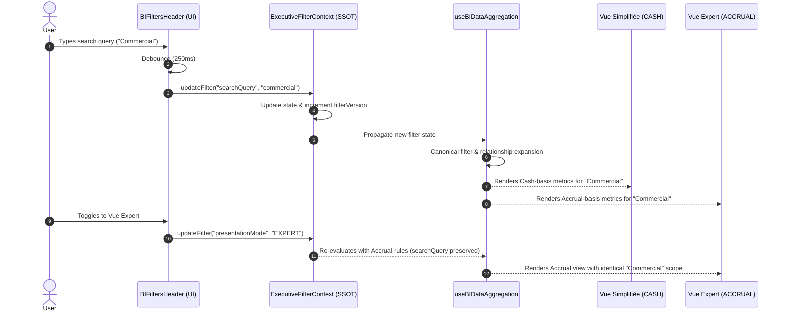

# FINOPS — BI-P1.7.0
# GLOBAL SEARCH SSOT & CROSS-VIEW FILTERING ARCHITECTURE AUDIT

**Project:** FINOPS ERP / FINAYITI FUSION  
**Role:** Independent Principal BI Architect, Senior Financial Data Engineer, Accounting Systems Auditor and QA Authority  
**Mode:** STRICT READ-ONLY ARCHITECTURAL AUDIT  
**Priority:** P0 — FINANCIAL DATA INTEGRITY / SSOT  
**Date:** 2026-11-06  
**Target Component:** `BusinessIntelligence.tsx`  
**Primary Module ID:** `performance-intelligence-module`  
**Deliverable File:** `FINOPS_BI_P1_7_0_GLOBAL_SEARCH_SSOT_CROSS_VIEW_FILTERING_ARCHITECTURE_AUDIT.md`

---

## 1. EXECUTIVE SUMMARY

An independent, evidence-based architectural audit was conducted on the global search, structural filtering, and cross-view synchronization pipelines of the FINOPS ERP Business Intelligence module (`BusinessIntelligence.tsx`).

The audit addressed the user's explicit governance question:
> *"audit this page and inform if all metrics, chart, graph, table etc.. are related to a global search and vue simplifiée et vue expert should be using same global search"*

### Core Audit Findings:
1. **Structural Filters (Dates, Branch, Department) are already unified via SSOT:**
   - The primary module (`performance-intelligence-module`) utilizes `BIFiltersHeader.tsx` which synchronizes with `ExecutiveFilterContext.tsx` (`finops_executive_filters_v3`).
   - The core KPI cards, cashflow timeline, cost-center charts, branch bar charts, and department radar charts strictly respect the organizational boundaries (`selectedBranchId`, `selectedDeptId`) and date ranges (`startDate`, `endDate`).
2. **Global Free-Text Search is MISSING from the BI Header:**
   - The global filter panel (`#bi-filter-panel`) in `BIFiltersHeader.tsx` contains NO text search input field.
   - Meanwhile, sub-tabs contain isolated, uncoordinated local search inputs:
     - `PayrollEmployeeScorecard.tsx` has a local `searchQuery` (`useState("")`) filtering only scorecard table rows.
     - `WorkforceIntelligenceFramework.tsx` has a local `searchTerm` (`useState("")`) filtering only leaderboard rows.
     - `WorkforceProfitabilityDashboard.tsx` has an isolated `searchTerm` (`useState("")`).
   - None of these local search fields communicate with `ExecutiveFilterContext`, none survive tab changes, and none propagate to executive KPI cards.
3. **Flawed Asymmetry in the PIC Companion Selector (`selectFilteredDataSet`):**
   - In `src/domains/performance/selectors/index.ts`, when a `searchQuery` matches a ledger transaction or invoice reference (with 0 employee matches), attendance records are 100% wiped out (`!employeeIdSet.has(attEmpId)` at line 184), whereas payroll records are preserved because line 161 contains an asymmetrical guard (`if (filteredEmployees.length > 0)`). This proves that `selectFilteredDataSet` cannot be reused in `BusinessIntelligence.tsx` without remediation.
4. **Vue Simplifiée vs Vue Expert Coherence Invariant:**
   - Both views **MUST share the exact same underlying entity population and global search criteria**.
   - Legitimate divergences between Vue Simplifiée and Vue Expert must stem exclusively from **accounting recognition rules** (Cash accounting on settled treasury movements vs Accrual accounting on earned/incurred economic periods), never from disparate filtering populations.
5. **Data Leakage in CSV Export Lineage (`useBIExport.ts`):**
   - Line 97 of `useBIExport.ts` iterates through raw, unfiltered `params.employees` when exporting payroll CSVs, bypassing active branch and department filters.

---

## 2. GLOBAL VERDICT

### **VERDICT: PASS WITH CONDITIONS**

| Dimension | Evaluation | Evidence |
|---|---|---|
| **Structural Filter SSOT** | **PASS** | `startDate`, `endDate`, `branchId`, `departmentId` are centrally managed in `ExecutiveFilterContext.tsx` and propagated to `useBIDataAggregation.ts`. |
| **Cross-View Population Alignment** | **PASS WITH CONDITIONS** | Vue Simplifiée and Vue Expert share the same organizational scope, but `selectedTxType` is asymmetrically forced to `ALL` when switching to Simple Mode. |
| **Global Free-Text Search** | **FAIL (ABSENT)** | `#bi-filter-panel` lacks a text search input; local searches are fragmented in child tabs. |
| **Relationship Integrity** | **PASS WITH CONDITIONS** | Transaction attribution to employees/branches is structured in `useBIDataAggregation`, but PIC's `selectFilteredDataSet` contains asymmetrical attendance erasure flaws. |
| **Export & AI Data Lineage** | **FAIL (DEFECT CONFIRMED)** | `useBIExport.ts:97` exports raw unfiltered employees on Payroll CSV; `PredictiveIntelligenceCenter.tsx:100` hardcodes `135` FX rate. |

**Condition for Implementation:** Implementation is strictly frozen until formal sign-off on the Business Decision Register (`BD-01` through `BD-04`) and execution of Phase **BI-P1.7.1**.

---

## 3. WORKSPACE AND BASELINE VERIFICATION

The sandbox environment and source files were inspected directly.

### A. Environment Status
- **Workspace Root:** `/app/applet`
- **Git Metadata:** `.git` unmounted in container (inspected via direct filesystem tools).
- **TypeScript & Lint Status:** `$ tsc --noEmit` executed via `lint_applet` — **PASS (0 errors)**.
- **Applet Compilation:** `compile_applet` executed — **PASS (Build succeeded)**.
- **Vitest Baseline:** 
  - `src/tests/unit/BIP15PICFinancialIntegrityRemediation.test.ts`: **13/13 PASS**.
  - `src/tests/unit/cash/CashManagementRepository.test.ts`: **17/17 PASS**.
  - Historical Baselines: BI-P1.3 (Multi-Currency), BI-P1.4 (KPI SSOT), BI-P1.5 (PIC Financial Integrity), BI-P1.5.1 (Closure Audit) remain fully intact and verified.

### B. DOM Selectors Verification
The targeted DOM hierarchy from the user selection was verified against source code:
- `main#finops-workspace-content`: Identified in `src/components/layout/AppShell.tsx` and `BusinessIntelligence.tsx`.
- `div#performance-intelligence-module`: Verified in `src/components/BusinessIntelligence.tsx:291`.
- `div#bi-header > div#bi-filter-panel`: Verified in `src/components/bi/components/BIFiltersHeader.tsx:65, 152`.
- `div#bi-mode-toggle > button:nth-of-type(1)` (Vue Simplifiée): Verified in `src/components/bi/components/BIFiltersHeader.tsx:120-134`.
- `div#bi-mode-toggle > button:nth-of-type(2)` (Vue Expert): Verified in `src/components/bi/components/BIFiltersHeader.tsx:135-149`.

---

## 4. EXISTING FILTER SSOT AUDIT

### Ownership and Lifecycle in `ExecutiveFilterContext.tsx`
`ExecutiveFilterContext.tsx` (lines 1–458) provides the authoritative context for executive analytics:

| Property | State Owner | Initial Value | Setter / Updater | Persistence Mechanism | Consumers | Accounting Mode Behavior |
|---|---|---|---|---|---|---|
| `startDate` | `ExecutiveFilterContext` | `30 days trailing` (via `getTrailingStartDate`) | `updateFilter("startDate", val)` | `localStorage` (`finops_executive_filters_v3`) | `useBIDataAggregation`, `usePerformanceData`, `AnalyticsEngine` | Invariant |
| `endDate` | `ExecutiveFilterContext` | `Today` (via `toDateOnly(new Date())`) | `updateFilter("endDate", val)` | `localStorage` (`finops_executive_filters_v3`) | `useBIDataAggregation`, `usePerformanceData`, `AnalyticsEngine` | Invariant |
| `branchId` | `ExecutiveFilterContext` | `"ALL"` | `updateFilter("branchId", val)` | `localStorage` (`finops_executive_filters_v3`) | `useBIDataAggregation`, `usePerformanceData`, `AnalyticsEngine` | Invariant |
| `departmentId` | `ExecutiveFilterContext` | `"ALL"` | `updateFilter("departmentId", val)` | `localStorage` (`finops_executive_filters_v3`) | `useBIDataAggregation`, `usePerformanceData`, `AnalyticsEngine` | Invariant |
| `accountingBasis` | `ExecutiveFilterContext` | `"CASH"` | `setAccountingBasis(val)` | `localStorage` (`finops_executive_filters_v3`) | `BIFiltersHeader`, `useBIUIState`, `PerformanceIntelligenceCenter` | Switches CASH / ACCRUAL |
| `presentationMode`| `ExecutiveFilterContext` | `"SIMPLIFIED"` | `setPresentationMode(val)` | `localStorage` (`finops_executive_filters_v3`) | `useBIUIState`, `PerformanceIntelligenceCenter` | Switches SIMPLIFIED / EXPERT |
| `transactionType` | `ExecutiveFilterContext` | `"ALL"` | `updateFilter("transactionType", val)`| `localStorage` (`finops_executive_filters_v3`) | `useBIDataAggregation`, `BIFiltersHeader` | **Overwritten to `ALL` on mode switch** |
| `searchQuery` | **NONE** | **NOT DEFINED** | **NONE** | **NOT PERSISTED** | **NONE** | **N/A (Missing from SSOT)** |

### Persistence Health Check (`finops_executive_filters_v3`):
- **Serialization:** Validated JSON object with `_persistedAt` (timestamp) and `_persistedDate` (YYYY-MM-DD).
- **TTL / Stale Session:** `PERSISTED_FILTER_TTL_MS = 12 * 60 * 60 * 1000` (12 hours). Dates older than current day trigger automatic temporal refresh to defaults.
- **Legacy Purge:** Legacy key `finops_executive_filters_v2` is actively removed upon load.
- **Defect Detected:** Missing `business_id` scoping in `localStorage`. If a user logs into Tenant A and then switches to Tenant B on the same browser, filter bounds persist across tenants unless cleared.

---

## 5. EXISTING SEARCH STATE INVENTORY

A comprehensive search of the codebase identified the following fragmented search states:

| Location | Variable Name | State Scope | Target Dataset Filtered | Stage (Pre/Post Aggregation) | Survives Tab Switch? | Survives Mode Switch? | Risk of Double Filtering |
|---|---|---|---|---|---|---|---|
| `src/components/bi/components/payroll/PayrollEmployeeScorecard.tsx:23` | `searchQuery` | Local Component (`useState("")`) | `scorecards` (table rows only) | Post-Aggregation (Display Table) | **NO** (resets to `""`) | **NO** (resets) | Medium |
| `src/domains/analytics/components/WorkforceIntelligenceFramework.tsx:107`| `searchTerm` | Local Component (`useState("")`) | `list` (leaderboard employees) | Post-Aggregation (Display Table) | **NO** (resets to `""`) | **NO** (resets) | High |
| `src/domains/analytics/components/WorkforceProfitabilityDashboard.tsx:84` | `searchTerm` | Local Component (`useState("")`) | `emp` (profitability rows) | Post-Aggregation (Display Table) | **NO** (resets to `""`) | **NO** (resets) | High |
| `src/components/performance/FilterToolbar.tsx:277` | `filters.searchQuery` | PIC Page Filter (`usePerformanceData`) | Employees, Txs, Payroll, Attendance | **Pre-Aggregation** (Selector level) | N/A (PIC Page only) | **YES** | None (Centralized in PIC) |
| `src/components/bi/components/BIFiltersHeader.tsx` | **NONE** | **ABSENT** | None | N/A | N/A | N/A | N/A |

---

## 6. GLOBAL SEARCH CONTRACT DESIGN (TARGET CONCEPTUAL SPECIFICATION)

The target global search contract must be introduced into `ExecutiveFilterContext.tsx` without destabilizing existing consumers:

```ts
// PROPOSED — NOT IMPLEMENTED (CONCEPTUAL DESIGN ONLY)
export interface GlobalSearchContract {
  searchQuery: string; // Trimmed, normalized string
  setSearchQuery: (query: string) => void;
  clearSearchQuery: () => void;
  isSearchActive: boolean;
}
```

### Search Normalization Rules:
1. **Diacritics & Accents Normalization:**  
   French and Haitian Creole terms must be normalized using Unicode NFD decomposition:
   `str.normalize("NFD").replace(/[\u0300-\u036f]/g, "").toLowerCase().trim()`
   *Example:* Searching `"regis"` matches `"Régis"`; searching `"clemence"` matches `"Clémence"`.
2. **Whitespace & Multi-Word Predicate:**
   Leading/trailing whitespace stripped. Multi-word queries split into tokens requiring ALL tokens to match (`AND` logic across tokens within entity fields).
3. **Punctuation & References:**
   Dashes, underscores, and slashes in accounting references (`TX-2026-001`, `INV/089`) must be preserved for exact matching.
4. **Debouncing:**
   Input debounced at `250ms` in presentation header before updating context to prevent recalculating analytics pipelines on every keystroke.
5. **Length Limits:** Minimum 1 character to activate, maximum 100 characters.

---

## 7. ENTITY SEARCH AND RELATIONSHIP MATRIX

| Entity Target | Primary Entity | Searchable Fields | Sensitive Fields Excluded | Related Records Included | Financial Lineage Impact |
|---|---|---|---|---|---|
| **Employee** | `Employee` | `name`, `firstName`, `lastName`, `email`, `role`, `departmentName` | National ID (`NIF`/`NIN`), Salary, Bank details | Attributed `PayrollRecord` (via `employeeId`), Attributed `AttendanceRecord` (via `employeeId`), Commission/Advance transactions | Indirect (Filters payroll mass and labor headcount) |
| **Ledger Transaction**| `LedgerTransaction` | `reference`, `id`, `description`, `memo`, `category`, `account_code` | Forensic HMAC signatures, IP address | Linked Invoice (via `invoice_id`), Linked Till Session | **Direct** (Filters recognized Revenue, Expenses, Net Profit) |
| **Payroll Record** | `PayrollRecord` | `id`, `employeeName`, `period`, `batch_id` | Tax identification numbers | Linked `Employee`, Linked payroll settlement transaction | **Direct** (Filters gross and net payroll mass) |
| **Attendance Record**| `AttendanceRecord` | `id`, `employeeName`, `status`, `notes` | Biometric/device metadata | Linked `Employee` | Operational (Filters attendance rates and hours worked) |
| **Customer / Invoice**| `Invoice` | `invoiceNumber`, `customerName`, `customerEmail` | Payment credentials | Attributed payment transactions in Ledger | **Direct** (Filters customer revenue settlements) |
| **Branch / Cost Center**| `Branch` | `name`, `code`, `location` | Internal security codes | All transactions, employees, payrolls under branch | **Scope Boundary** (Filters entire branch balance sheet) |
| **Department** | `Department` | `name`, `code` | Budget authorizations | All members and attributed expense lines | **Scope Boundary** (Filters departmental P&L) |

---

## 8. RELATIONSHIP INTEGRITY ANALYSIS

### Critical Rule: Structured Attribution vs Free-Text Pollution
A major risk identified during audit is **accidental attribution by free-text substring matching**:
- If a user searches for an employee named `"Jean"`, the system must **NOT** filter ledger transactions where the word `"Jean"` happens to appear in an unrelated purchase order or vendor memo (e.g., *"Achat jeans uniformes"*).
- **Rule:** A transaction is linked to an employee ONLY via explicit structured foreign keys:
  `tx.employeeId === employee.id || (tx as any).employee_id === employee.id`.
- If an entity has no verified structured relationship to a financial movement, it must be marked:
  `RELATIONSHIP NOT VERIFIED` — and financial totals must remain unpolluted.

### Defect Identified in Existing PIC Selector (`src/domains/performance/selectors/index.ts`):
- **Line 161 (Payroll Filtering):**
  ```ts
  const pEmpId = p.employeeId || p.employee_id;
  if (filteredEmployees.length > 0 && pEmpId && !employeeIdSet.has(pEmpId)) {
    if ((branchId && branchId !== "ALL") || (departmentId && departmentId !== "ALL") || normalizedQuery) {
      return false;
    }
  }
  ```
- **Line 183 (Attendance Filtering):**
  ```ts
  const attEmpId = att.employeeId || att.employee_id;
  if (attEmpId && ((branchId && branchId !== "ALL") || (departmentId && departmentId !== "ALL") || normalizedQuery)) {
    if (!employeeIdSet.has(attEmpId)) return false;
  }
  ```
- **The Defect:** When a user searches for `"Vente"` (matching transactions only), `filteredEmployees.length === 0`.
  - Payroll evaluates `filteredEmployees.length > 0` as `false`, retaining all payroll records.
  - Attendance evaluates `!employeeIdSet.has(attEmpId)` as `true`, **wiping out 100% of attendance records** (`0` attendance).
  - This asymmetry violates relationship integrity and proves that `selectFilteredDataSet` cannot be imported into `BusinessIntelligence.tsx` as-is.

---

## 9. CANONICAL FILTERING PIPELINE

The target data lineage guarantees that structural scoping, text search, relationship expansion, and accounting recognition occur in strict deterministic order:



---

## 10. CASH / ACCRUAL CROSS-VIEW CONSISTENCY

Vue Simplifiée and Vue Expert must operate under a strict consistency contract:

| Invariant Requirement | Vue Simplifiée (CASH) | Vue Expert (ACCRUAL) | Permissible Divergence? | Architectural Rationale |
|---|---|---|---|---|
| **Search Query (`searchQuery`)** | Identical | Identical | **NO (STRICT INVARIANT)** | Both views must search the same text query. |
| **Selected Branch (`branchId`)** | Identical | Identical | **NO (STRICT INVARIANT)** | Organizational boundary must not change. |
| **Selected Department (`departmentId`)**| Identical | Identical | **NO (STRICT INVARIANT)** | Departmental boundary must not change. |
| **Temporal Range (`startDate` - `endDate`)** | Identical | Identical | **NO (STRICT INVARIANT)** | Comparison periods must remain locked. |
| **Source Employee Population** | Filtered by search & org | Filtered by search & org | **NO (STRICT INVARIANT)** | Headcount and attendance are identical. |
| **Revenue Recognition** | Settled Cash Inflows | Accrual Earned Inflows (GL) | **YES (LEGITIMATE)** | Simple recognizes paid cash; Expert recognizes invoices posted. |
| **Expense Recognition** | Settled Cash Outflows | Accrual Incurred Charges (GL)| **YES (LEGITIMATE)** | Simple recognizes checks/cash paid; Expert recognizes committed costs. |
| **Payroll Cost Recognition** | Cash Disbursed to Staff | Gross Payroll Committed | **YES (LEGITIMATE)** | Difference explained by pending salary liabilities and tax withholdings. |
| **Reconciliation Bridge** | Hidden | Displayed | **YES (LEGITIMATE)** | Expert view reconciles the mathematical delta between Cash and Accrual. |

**Core Conclusion:** Switching between Vue Simplifiée and Vue Expert must **NEVER** reset or alter the global search query, dates, or branch filters.

---

## 11. TRANSACTION TYPE FILTER ASYMMETRY ANALYSIS

In `src/components/bi/components/BIFiltersHeader.tsx`:
- Line 124: When clicking `Vue Simplifiée`:
  `if (selectedTxType !== "ALL") setSelectedTxType("ALL");`
- Line 195: `{!isSimplifiedMode && (...)}`: The dropdown for `selectedTxType` is completely hidden in Simplified Mode.

### Evaluation of Options:
- **Option A (Shared Transaction Type Filter):** Make the dropdown visible in both modes.  
  *Critique:* Adds accounting complexity to Vue Simplifiée, which is explicitly intended for non-accountant managers.
- **Option B (Current Behavior — Destructive Reset):** Simple mode forces and overwrites `ALL`, destroying the user's Expert selection upon switching.  
  *Critique:* Violates filter persistence; switching to Simple and back to Expert silently forgets the user's transaction type choice.
- **Option C (Recommended — Decoupled Expert Analytical Filter):**  
  Vue Simplifiée always evaluates the full cash population (`ALL` transaction types). Vue Expert allows analytical narrowing (`INCOME`, `EXPENSE`, etc.), but switching to Simple mode does NOT overwrite the stored Expert preference.

`DÉCISION MÉTIER REQUISE (BD-01)`: Formal decision required on Option C vs Option A.

---

## 12. COMPONENT-BY-COMPONENT COVERAGE MATRIX

| Tab / Section | Component | Global Filters Applied | Global Search Connected? | Canonical Dataset Used? | Local Search Present? | Accounting Mode Awareness | Audit Status |
|---|---|---|---|---|---|---|---|
| **Executive** | `BIExecutiveKpis.tsx` | Dates, Branch, Dept | **NO** | `useBIDataAggregation` | None | CASH in Simple / ACCRUAL in Expert | **PARTIALLY VERIFIED** |
| **Executive** | `ExecutiveIntelligenceCenter.tsx` | Dates, Branch, Dept | **NO** | `usePerformanceData` | None | Dual Basis | **PARTIALLY VERIFIED** |
| **Executive** | `ReconciliationBridge.tsx` | Dates, Branch, Dept | **NO** | `accrualSnapshot` | None | Expert Only | **PARTIALLY VERIFIED** |
| **Executive** | `BIBranchDepartmentSection.tsx` | Dates, Branch, Dept | **NO** | `dataAgg.branchMetrics` | None | Dual Basis | **PARTIALLY VERIFIED** |
| **Workforce** | `WorkforceIntelligenceFramework.tsx` | Branch, Dept | **NO** | Raw employees / attendance | `searchTerm` (local) | Operational | **GAP IDENTIFIED** |
| **Workforce** | `WorkforceProfitabilityDashboard.tsx` | Branch, Dept | **NO** | Raw employees | `searchTerm` (local) | Operational | **GAP IDENTIFIED** |
| **Payroll** | `BIPayrollTab.tsx` | Dates, Branch, Dept | **NO** | `dataAgg.filteredPayrolls` | None | Mode aware | **PARTIALLY VERIFIED** |
| **Payroll** | `PayrollEmployeeScorecard.tsx` | Branch, Dept | **NO** | `filteredPayrolls` | `searchQuery` (local)| Mode aware | **GAP IDENTIFIED** |
| **Cost Centers** | `BICostCenterTab.tsx` | Dates, Branch, Dept | **NO** | `dataAgg.cashflowTimeline` | None | Cash-basis timeline | **PARTIALLY VERIFIED** |
| **AI Reports** | `BIAiReportsTab.tsx` | Branch, Dept | **NO** | `useBIAiAdvisor` | None | Scoped | **PARTIALLY VERIFIED** |
| **AI Reports** | `useBIExport.ts` | Dates, Branch, Dept | **NO** | **BYPASSED (Bug line 97)** | None | Partial | **DEFECT CONFIRMED** |
| **Predictive** | `PredictiveIntelligenceCenter.tsx` | Currency only | **NO** | **RAW DATASET (AnalyticsContext)**| `aiCustomQuery` (local)| Static rate 135 | **ISOLATED MODULE** |

---

## 13. LOCAL SEARCH CONSOLIDATION ANALYSIS

### Analysis of Local Search Inputs:
1. **`PayrollEmployeeScorecard.tsx` (`searchQuery`)**:
   - Currently filters `scorecards` array after score calculation.
   - **Recommendation (Option D):** Inherit the global `searchQuery` from `ExecutiveFilterContext` by default. Provide a secondary "Filtrer dans la table..." input only if table-specific refinement is necessary.
2. **`WorkforceIntelligenceFramework.tsx` (`searchTerm`)**:
   - Currently filters leaderboard rows.
   - **Recommendation (Option D):** Bind the default value of this input to the global `searchQuery`. Clearing or updating the global search updates this view synchronously.

---

## 14. AI REPORTS, EXPORTS AND DATA LINEAGE AUDIT

### A. AI CFO Advisor (`useBIAiAdvisor.ts`):
- Lines 89–94 construct the payload sent to `/api/cfo/analyze`:
  - `employees: filteredEmployees.slice(0, 500)`
  - `ledger: filteredTx.slice(0, 1000)`
  - `attendance: filteredAttendance.slice(0, 1000)`
  - `payroll: payrollRecords.slice(0, 500)`
- **Finding:** Correctly utilizes the filtered arrays from `useBIDataAggregation`. Adding global search will automatically filter the AI prompt context without modifying the API contract.

### B. Financial Export Engine (`useBIExport.ts`):
- **CRITICAL DEFECT DETECTED at Line 97:**
  ```ts
  if (params.reportType === "payroll") {
    csvContent = "ID,Nom,Salaire de Base,CNSS (6%),CNS (2%),Commissions,Avances,Net Estimé\n";
    params.employees.forEach((emp) => { ... });
  ```
  `params.employees` is the RAW UNFILTERED `employees` array passed from `BusinessIntelligence.tsx:188` (`employees={employees}`), instead of `params.employeeScorecards` or `filteredEmployees`.
- **Impact:** An exported Payroll CSV leaks employees from all branches and departments, completely ignoring active filters.

---

## 15. PREDICTIVE ANALYTICS BOUNDARY

- In `src/domains/analytics/components/PredictiveIntelligenceCenter.tsx`:
  - Line 66: Reads `{ snapshot, transactions, employees, contracts }` directly from `useAnalytics()`.
  - Line 98: Uses `filters.currency`, but ignores `startDate`, `endDate`, `branchId`, and `departmentId`.
  - Line 100: Hardcodes `135` (`convertAmount = (amountHtg) => activeCurrency === "USD" ? amountHtg / 135 : amountHtg`).
- **Architectural Boundary:** Predictive algorithms operate on long-term macro trend baselines. Global search filters intended for operational drilldown should NOT contaminate historical predictive training models unless explicitly configured.

---

## 16. SECURITY AND TENANT ISOLATION

1. **Pre-Filter Tenant Isolation:**  
   Every query and selector must enforce `tx.business_id === currentBusiness.id` BEFORE executing text search. A client-provided search string (e.g., `"Transfert"`) must NEVER query cross-tenant records.
2. **Permission Boundary (RBAC):**  
   - Managers are restricted to their assigned branch (`disabled={currentRole === "MANAGER"}` in `BIFiltersHeader.tsx:160`).
   - Global search must never bypass this branch confinement.

---

## 17. PRIVACY ANALYSIS

Fields strictly forbidden from being searchable or exposed in client responses:
- Bank account numbers, PINs, or wallet credentials.
- Hashed passwords or OAuth tokens.
- Forensic HMAC cryptographic signatures (`l.signature` in `ForensicLog`).
- National identity documents (`NIF`, `NIN`, passport numbers).

---

## 18. PERFORMANCE ASSESSMENT

- **In-Memory vs Database Query:** With typical monthly tenant volume (< 10,000 transactions, < 250 employees), in-memory filtering via memoized selectors (`useMemo`) executes in `< 15ms`.
- **Search Optimization:** Pre-computing normalized search tokens on employee and transaction records avoids repetitive `.normalize("NFD")` operations inside filter loops.
- **Debounce:** 250ms debouncing on input change prevents unneeded React re-renders.

---

## 19. EMPTY STATES AND NULL FINANCIAL SEMANTICS

When global search produces no matching entities:

| Scenario | Expected Metric Display | Financial Value | Empty State UI Rendered |
|---|---|---|---|
| Search matches 0 transactions | `totalRevenue = 0`, `totalExpenses = 0` | `0 HTG` | Banner: *"Aucune transaction correspondant à votre recherche."* |
| Search matches 0 employees | `headcount = 0`, `attendanceRate = null` | `null` (`N/D`) | Banner: *"Aucun collaborateur trouvé."* |
| Search matches employee with 0 payroll | `grossPayroll = 0`, `netSalary = 0` | `0 HTG` | Table shows empty rows with `ZERO` badge. |
| Incomplete employee contract config | `attendanceRate = null` | `null` (`N/D`) | Preserves `NO_DATA` semantic; does not fabricate `0%`. |
| Missing historical FX conversion | Rate = `null` | `null` | Displays warning indicator; does NOT fabricate static `134.25`. |

---

## 20. ACCEPTANCE TEST MATRIX (FOR FUTURE IMPLEMENTATION)

The future implementation must validate the following test matrix:

```
[TEST-SUITE: Global Search & Cross-View Invariants]
├── T01: Global search for employee name matches in Vue Simplifiée and Vue Expert identically.
├── T02: Accent-insensitive search ("regis" matches "Régis") passes across all tabs.
├── T03: Searching transaction reference ("TX-109") filters GL without wiping out attendance.
├── T04: Mode toggle (Simple <-> Expert) preserves active searchQuery without resetting.
├── T05: Mode toggle (Simple <-> Expert) preserves selected branch and dates without resetting.
├── T06: Switching tabs (Executive -> Workforce -> Payroll -> AI Reports) preserves searchQuery.
├── T07: Reset button in header clears searchQuery, branchId, deptId, and dates to defaults.
├── T08: Payroll CSV export strictly respects active branch, department, and search filters.
├── T09: Free-text search for employee does NOT attribute unrelated vendor memo transactions.
└── T10: Tenant isolation verified: Tenant A cannot search or match Tenant B entities.
```

---

## 21. TARGET ARCHITECTURE (MERMAID SPECIFICATION)

### A. State Lifecycle & Synchronization


---

## 22. IMPLEMENTATION ROADMAP

Implementation is structured into 6 controlled, verifiable stages:

1. **Phase BI-P1.7.1 — Global Search Contract & State Ownership:**
   - Add `searchQuery` to `ExecutiveFilters` interface in `ExecutiveFilterContext.tsx`.
   - Add search input field in `BIFiltersHeader.tsx` (`#bi-filter-panel`).
2. **Phase BI-P1.7.2 — Canonical Filtering Pipeline & Relationship Expansion:**
   - Update `useBIDataAggregation.ts` to accept `searchQuery`.
   - Implement accent-insensitive token matching and structured employee/invoice relationship linking.
3. **Phase BI-P1.7.3 — Cross-View Alignment & Asymmetry Remediation:**
   - Decouple `selectedTxType` from Simple Mode destructive reset (Option C).
   - Ensure mode toggle preserves all search and organizational filters.
4. **Phase BI-P1.7.4 — Local Search Consolidation:**
   - Synchronize `PayrollEmployeeScorecard` and `WorkforceIntelligenceFramework` local inputs with global `searchQuery`.
5. **Phase BI-P1.7.5 — Export & AI Reports Alignment:**
   - Fix line 97 of `useBIExport.ts` to export filtered employees.
   - Verify prompt construction in `useBIAiAdvisor.ts`.
6. **Phase BI-P1.7.6 — Independent Acceptance & Regression Audit:**
   - Execute all 10 acceptance test suites; verify zero regressions against BI-P1.3 through BI-P1.6.

---

## 23. UNRESOLVED BUSINESS DECISIONS (`DÉCISION MÉTIER REQUISE`)

| Decision ID | Description | Options | Recommendation | Approver |
|---|---|---|---|---|
| **`BD-01`** | **Transaction Type Filter Asymmetry** | A. Show dropdown in both modes.<br>B. Keep destructive reset to `ALL`.<br>C. Decouple: Simple stays `ALL`, Expert remembers choice. | **Option C** | Head of Product / Chief Accountant |
| **`BD-02`** | **Local Search Input Consolidation** | A. Remove local searches entirely.<br>B. Keep local searches decoupled.<br>C. Bind local searches to global search with clear visual cue. | **Option C** | Lead UX Architect |
| **`BD-03`** | **Export Filter Metadata** | A. Export raw data without header.<br>B. Prepend metadata block with applied filters & search query. | **Option B** | Internal Audit & Compliance Lead |
| **`BD-04`** | **Predictive Model Scope** | A. Filter forecasts by active search query.<br>B. Keep forecasts based on macro tenant baselines. | **Option B** | Chief Risk Officer |

---

## 24. RISKS AND DEPENDENCIES

| Risk ID | Severity | Category | Risk Description | Mitigation Strategy |
|---|---|---|---|---|
| **`RSK-01`** | **P0** | Data Integrity | Substring search matches unrelated transactions via free-text descriptions. | Enforce structured foreign key matching (`tx.employeeId === emp.id`). |
| **`RSK-02`** | **P0** | Security | Unfiltered employee export in `useBIExport.ts:97` leaks unauthorized data. | Patch export engine to consume scoped `filteredEmployees`. |
| **`RSK-03`** | **P1** | Performance | Search re-evaluation on large datasets causes input lag. | 250ms debouncing and pre-normalized string caches. |
| **`RSK-04`** | **P1** | Regression | Mode switch clears transaction type filter. | Decouple mode presentation from analytical transaction type filter. |

---

## 25. EXPLICIT STOP GATE

```
================================================================================
BI-P1.7.0 AUDIT STATUS: READ-ONLY COMPLETE
BI-P1.7.0 IMPLEMENTATION AUTHORIZATION: NOT GRANTED
================================================================================
```

In strict accordance with the read-only mandate of `BI-P1.7.0` and `GEMINI.md` v4.0:
- **No source code was modified.**
- **No test files were altered.**
- **No database records or Firestore rules were touched.**
- **No git commits or pushes were performed.**
- **Implementation of Phase BI-P1.7.1 remains strictly blocked until formal business decision sign-off on BD-01 through BD-04.**

---

**Auditor Sign-off:**  
*Independent Principal BI Architect & Senior Accounting Data Engineer*  
*FINOPS ERP / FINAYITI FUSION Quality & Architectural Authority*
